# 问玄东方视觉设计与交互手册

产品版本：**0.0.1** · 文档修订：**2026-11-09**。

面向产品发布、设计合作、研发与验收。问玄东方把文化与服务发现、咨询交流、AI 问事和东方珠作创作连接起来：页面让用户找到合适的入口，流程让每一步的状态、费用与结果可理解。用户包括普通用户与信众，服务供给包括寺院、独立师傅和平台合作方；后台按身份与职责提供作业入口。

本手册先说明对外体验，再分别给出视觉规范和交互规范。统一概念与方案关系见[当前产品与方案总纲](../product/当前产品与方案总纲.md)，具体操作见[产品使用手册](产品使用手册.md)，合作职责见[运营与合作手册](运营与合作手册.md)。本文“应”表示交付要求，标注“当前源码”的内容表示本次核对结果；上线、真实交易和设备体验以对应验收为准。

## 1. 产品体验与信息架构

用户先发现，再了解，再决定是否登录、付费或提交；不以装饰动画制造虚假的服务进展。寺院与师傅的资料、服务、预约和回执各有明确来源，AI 内容保留资料与计算依据，DIY 让可编辑草稿、公开定稿和成交订单各有自己的位置。

| 场景 | 对外呈现 | 设计要点 |
| --- | --- | --- |
| 找寺庙 / 找师傅 | 标准分类、地区、服务与真实评分 | 筛选状态可见，列表摘要与详情分工明确 |
| 按心愿办 | 左侧固定纯文字标题，右侧七类心愿横滑 | 标题无卡底、不随入口滚动；保留实际配置名称及服务路径 |
| DIY 手串 | 首页开始设计进入二级广场列表，列表内切换我的设计 | 推荐作品紧贴主入口，创作从二级页面进入编辑器 |
| AI 问事 | 探索、问 AI、我的报告 | 免费摘要、付费完整报告和追问状态清楚 |
| 商城与资产 | 现金商城、积分中心、钱包、成长 | 金额、积分和成长值各有单位与规则 |
| 合作服务与运营 | 法师工作台、寺院管理台、统一运营管理台 | 本人、本寺、平台范围明确，菜单显示不代替权限控制 |

信众 H5 根导航为“首页、对话、AI问事、商城、我的”；法师 H5 为“工作台、预约、消息、我的”。搜索只在信众首页提供全站入口，目录页面内搜索保留自己的范围；退出放在“我的”。东方珠作是产品内创作品牌，不另设一套账号或资产。

## 2. 视觉规范：方向与双主题

浅色以米白、松绿、古金表达安静和秩序；深色以深棕、朱砂、暖金保持阅读层次。东方纹样、细线和材质承担品牌表达，标题、数据和主操作承担任务表达；不以更多边框和更大的留白代替内容层级。照片、头像和材料纹理不随主题整体染色。

外观提供“浅色、深色、跟随系统”；语言提供“简体中文、繁體中文、跟随系统”，其他系统语言回退简体。登录页和登录后的设置均需可达；切换语言或主题保留当前资料、选项和任务状态。网页与原生遵循相同语义，保留各自控件与安全区。

下表是共同颜色源的完整语义清单。Web 的品牌默认值映射主按钮与主要选择状态；古金、暖金用于强调和细节。相邻表面以层级区分，不把每张卡片做成独立的高对比色块。

| 语义 | 浅色 | 深色 | 使用位置 |
|---|---|---|---|
| 页面底 `bg.primary` | `#F6F3EC` | `#1C1210` | 页面、根导航背景 |
| 主表面 `bg.secondary` | `#FFFDF8` | `#2A1E1A` | 卡片、弹层、表格主体 |
| 次表面 `bg.tertiary` | `#EFEDE3` | `#3A2C25` | 输入区、分段底、表头 |
| 提升表面 `bg.elevated` | `#E7E7DA` | `#44342C` | 悬停、局部层次 |
| 品牌 `brand.default` | `#284D43` | `#C45A3C` | 主操作、选中项 |
| 品牌亮 `brand.light` | `#426A59` | `#D4735A` | 悬停、渐变终点 |
| 品牌深 `brand.dark` | `#1E3C34` | `#A64830` | 渐变或深一级强调 |
| 点缀 `accent.default` | `#84673D` | `#C8A96E` | 金色细线、强调、焦点 |
| 点缀亮 `accent.light` | `#896B40` | `#D4BC8A` | 局部强调文字 |
| 点缀深 `accent.dark` | `#72562F` | `#A88A50` | 点缀的较深层次 |
| 朱砂 `cinnabar.default` | `#A04B3A` | `#B5453A` | 专门的朱砂装饰角色 |
| 朱砂亮 `cinnabar.light` | `#B5614D` | `#CC5A4F` | 朱砂的辅助层次 |
| 主文字 `text.primary` | `#253E36` | `#F0E6DA` | 标题、主要内容 |
| 次文字 `text.secondary` | `#66736C` | `#C5B097` | 说明、标签、次要数据 |
| 弱文字 `text.tertiary` | `#748078` | `#8A7A6A` | 占位、低优先级说明 |
| 品牌上文字 `text.onBrand` | `#FFFFFF` | `#FFFFFF` | 主按钮文字 |
| 点缀文字 `text.onAccent` | `#FFFFFF` | `#1C1210` | 点缀实底上的文字 |
| 成功 `state.success` | `#357052` | `#5B8C5A` | 成功、完成状态 |
| 警告 `state.warning` | `#906D37` | `#D4A843` | 待处理、需关注 |
| 错误 `state.error` | `#A04B3A` | `#C45A3C` | 错误、失败、危险说明 |
| 信息 `state.info` | `#426A89` | `#8FAECB` | 中性信息 |
| 普通边框 `border.default` | `rgba(40,77,67,.14)` | `rgba(200,169,110,.15)` | 必要数据分隔、输入与状态边界；不用于普通卡片外框 |
| 强边框 `border.strong` | `rgba(40,77,67,.30)` | `rgba(200,169,110,.30)` | 焦点、选中、校验等明确状态；不用于普通次按钮外框 |
| 分隔线 `border.divider` | `rgba(40,77,67,.08)` | `rgba(200,169,110,.08)` | 行、段落之间 |

带透明度的色值按源文件的 RGBA 使用；若工具只接受八位 HEX，三种浅色边框依次为 `#284D4324`、`#284D434D`、`#284D4314`，深色为 `#C8A96E26`、`#C8A96E4D`、`#C8A96E14`。这是 alpha 的量化表示，实际叠加色仍取决于下方表面。

H5 为深色成功文字另提供 `#86B985`，浅色为 `#357052`，避免用较暗的成功填色直接排小字。阴影在浅色以 `37,62,54` 为底、深色以黑色为底；透明导航和玻璃表面从当前主题生成。后台 Element Plus 的文字、边框、遮罩、选择器和 ECharts 图表均映射这些角色，不能只更换页面底色。

状态还须有文字或图形。付款成功、已收货、积分扣减和成长值不能因为采用同一绿色便合并为一种业务状态。预览中的五行色点用于材料分类；它们不替代可读的“金、木、水、火、土”，也不是功效证明。

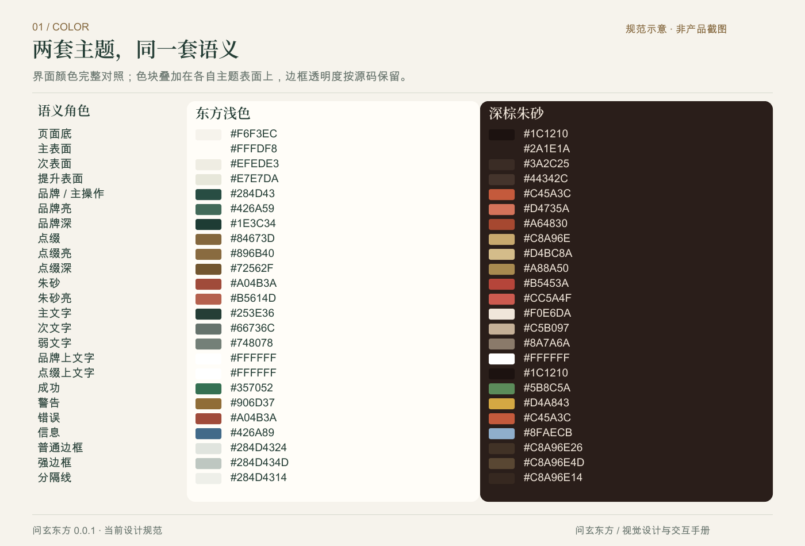

图 1：根据设计令牌生成并随本次源值核对的完整语义色板，属于规范图。带透明度边框使用八位 HEX 标记；Logo 专用色见下一章。

## 3. 视觉规范：品牌标识与资源

六种身份共用圆融的外框、圆点与线条结构；辨认由内部图形和名称完成。正式图形是同源 SVG，图内不嵌入缩小后无法阅读的中文。中文名称继续由产品衬线字体排版。

| 文件身份 | 显示名称 | 图形主题 | 当前应用 |
|---|---|---|---|
| `customer` | 问玄东方 | 日出山川 | 信众 H5、信众 iOS、母品牌 |
| `master` | 法师工作台 | 一灯明心 | 法师 H5、法师 iOS |
| `temple` | 寺院管理台 | 檐下安宁 | 寺院后台 |
| `shop` | 商城业务身份 | 相遇成环 | 保留的品牌资产，不代表独立商城工程或独立登录体验 |
| `platform` | 统一运营管理台 | 四方有序 | 统一运营后台及其中商城作业 |
| `atelier` | 东方珠作 | 一珠一念 | H5 DIY 广场、编辑和相关页面 |

页内浅版使用松绿 `#244C43`、古金 `#987342`；深版使用暖金 `#E5CCA3`、陶朱 `#D98B70`。这是图形专用色，和主按钮的 `#284D43`、`#C45A3C` 有意分开，不能用 CSS 滤镜强行改成按钮色。品牌展示板的深底 `#241A17` 也不替代应用页面底 `#1C1210`。

页面优先引用 `logo-{身份}-{light|dark}.svg`，原始视框为 96×96。透明 PNG 是 512×512 备用资源。保持等比、完整透明区域及镂空，用 `contain`；不要裁圆、拉伸、添加第二圈边框或再套一个有底色的图标壳。独立标识提供名称；紧邻同名文字时作为装饰隐藏，避免屏幕阅读器重复朗读。

页头、登录、侧栏与东方珠作导航使用各自共享组件规定的标识槽位，无需把透明图案放大到挤满外框。设计交付写明图形盒尺寸和周围留白，不只标图案可见边缘；原生按 pt、Web 按 px 分别校对。

应用图标使用完整、不透明的 1024px 方图，由系统裁出轮廓。信众浅版底色为 `#244C43`，法师为 `#A94132`，深色图标为 `#241A17`；应用内的主题设置不等于切换系统桌面图标。图形按生成器的 90% 光学盒放置，保留 maskable 安全区。Apple touch 图标为 180px；H5 信众与法师另有 192/512px 安装图标。

favicon 是单独的 SVG 资源，在 16、24、32px 下核对轮廓。它取消应用图标的额外缩放留白，不能拿 1024px 图标简单替代；其内部外观规则跟随浏览器系统媒体查询，页内 Logo 则跟随应用实际 `data-theme`。业务后台资源按 `/admin/`、`/temple/` 部署基路径加载；旧 `/shop/` 迁移页自包含，不依赖已删除商城工程的品牌或组件 bundle。

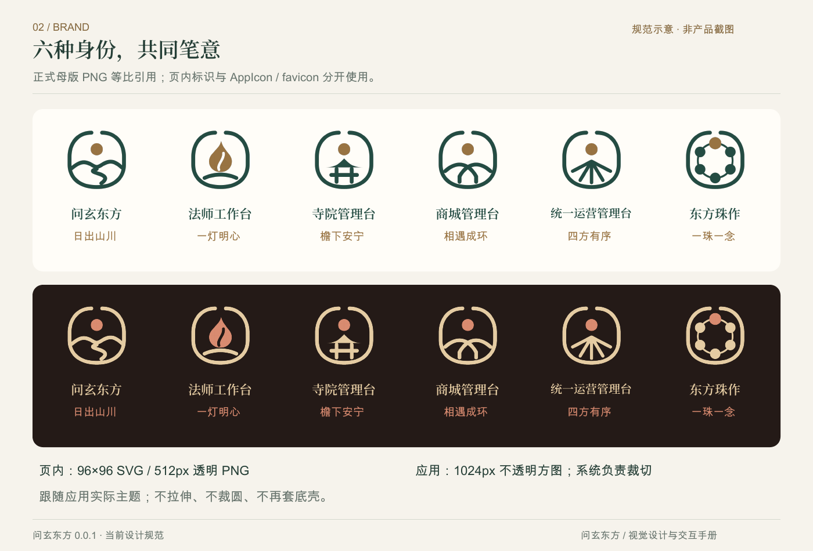

图版中的“商城管理台”是原品牌资产名称；商城业务现归入总管理台。六枚标识表示品牌角色，不表示六个应用或仍有第三个业务 Web 构建工程。

图 2：直接引用正式母包透明 PNG 的品牌规范图。概念探索图不作为正式资产；商城兼容入口转入统一后台，不另造独立首页。

## 4. 视觉规范：字体与数字

标题使用 AskXuan Serif 半粗字形，保留宋体的东方气质；正文、说明、按钮和输入使用系统无衬线。Web 标题回退序列为 AskXuan Serif、Noto Serif SC、Songti SC、STSong、SimSun；正文优先 Apple 系统字体，后续为 PingFang SC、Noto Sans SC、Microsoft YaHei。代码才使用 SFMono-Regular、Consolas 等等宽字体。

| 文字角色 | Web 基准字号 | 典型位置 |
|---|---:|---|
| micro / caption / label | 11 / 12 / 13px | 小标签、说明、字段标签 |
| body / control / reading | 14 / 15 / 16px | 正文、按钮输入、阅读内容 |
| nav / card / section | 17 / 18 / 20px | 导航、卡片标题、区块标题 |
| page / hero / display | 24 / 28 / 32px | 页面标题、主视觉标题 |
| metric / largeMetric | 36 / 48px | 重点统计，须有单位和名称 |

共同字重为 400 常规、500 中等、600 半粗。标题通常 600，正文 400，控件依组件为 500 或 600；不再逐页混用 700、800 制造层级。标题行高 1.5，正文 1.7，长阅读 1.9，控件 1.5。H5 普通标题字距约 `.02em`，DIY 导航等品牌位置可有专门字距。当前首页整体采用衬线体系，含局部控件；这是首页的现有设计，不扩展为全站表单规则。价格、表格与表单不加装饰性字距。

标题不伪造粗体。Web 字体以 `unicode-range` 分片按需加载，主片承载当前界面用字，其余汉字按文本实际需要请求；不要预加载全部分片，也不要删去动态用户内容可能需要的字符。字体文件受 OFL 许可约束，交付资产应保留许可文件。

价格、余额、积分、计数和表格数据用无衬线及 `tabular-nums lining-nums`，稳定每位数字宽度；代码编号可按可读性使用等宽字体，普通金额不改成代码样式。价格显示小数位、数量单位与币种分开核对，不能以视觉统一为理由改变四舍五入或金额来源。

iOS 使用相同的标题角色，但正文是原生语义字体：默认 subheadline 约 15pt、阅读 body 约 17pt、辅助 footnote 约 13pt、caption 约 12pt、caption2 约 11pt。标题通过 `relativeTo`，导航通过 `UIFontMetrics` 随 Dynamic Type 缩放；数字通过 `@ScaledMetric` 和 `monospacedDigit` 放大。Web px 与原生 pt 不按一比一截图尺寸强行对齐。

输入在 H5 粗指针设备上至少采用 16px 阅读字号，避免 iOS 浏览器聚焦时放大。标题、长姓名、物流单号及订单名称允许换行或在明确摘要位省略；完整信息须在详情可读。大字号验收应检查按钮可增长、标签能换行、单位未被裁掉。

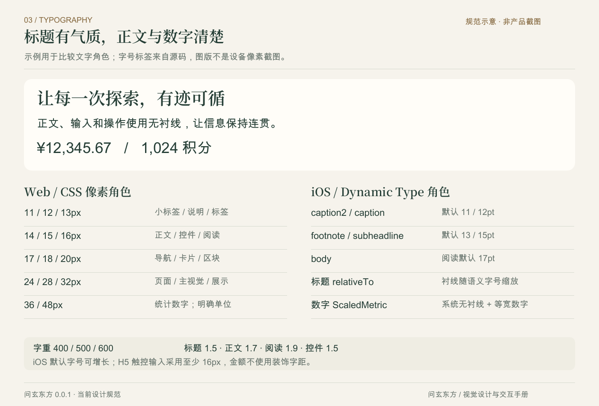

图 3：字体角色规范示意，使用正式品牌字体与无衬线排版。iOS 数值为默认字号档，动态字体可继续增长；本图不是原生应用截图。

## 5. 视觉规范：布局、密度与响应式

间距沿用 4、8、12、16、24、32 的节奏。紧密关联的信息放近，业务区块以标题和留白区分；普通筛选、取消和局部工具尽量轻，不给每个可点元素加独立外框。Web 普通卡片和按钮默认无描边，以当前主题表面、间距和色差分组；必要数据分隔、选中、焦点和输入错误状态仍清楚可见。强投影用于弹层。

| 区域 | 当前布局 | 交付要求 |
| --- | --- | --- |
| H5 普通页面 | 最大壳宽 1280px；普通阅读区在宽屏收窄，发现与目录页可用完整壳宽 | 左右留白、安全区、底部导航和操作条协调 |
| 首页 | 两个主入口、左侧固定文字心愿标题与右侧横滑、独立 DIY、积分中心、热门推荐 | 同一左右基线；卡片保持紧凑高度，不恢复四入口等大布局或首页信仰区 |
| DIY 编辑器 | 当前源码为受视口约束的工作区；宽屏预览和材料并排，899px 及以下上下排布 | 优先预览可用尺寸，材料区独立滚动；短屏与横屏另作适配 |
| 运营 Web | 稳定侧栏、页头、筛选、表格及详情；窄屏改导航抽屉 | 表格在容器内横滚，不能撑宽整页；关键操作仍可达 |
| 原生 iOS | 原生导航栈、sheet、安全区和动态字号 | 按 pt 与语义字体排版，不以截图等比缩放对齐 Web |

普通 H5 主次按钮通常为 10px 圆角，当前首页卡片为 12px；后台对话框为 16px。DIY 当前预览区与材料区采用轻量无框结构，不再按旧图恢复 22px 台面框、20px 材料板和固定 5:4 画布。具体组件使用既有样式，不能因统一数值而批量改变交互命中区。

通用 H5 操作目标至少 44px，iOS 主次按钮至少 48pt；紧凑工具的可见图形可以更小，但应验证命中区域。当前部分 DIY 工具仍存在 30–40px 局部高度，需设备专项检查，不据通用规范宣称全部触点已达标。长姓名、繁体文案、大字号、价格单位和状态允许合理换行。

## 6. 视觉规范：首页与发现页面

当前 Web 首页顺序为运营展示 → 找寺庙 / 找师傅 → 虚拟园区 → 按心愿办 → DIY 手串 → 积分中心 → 热门寺院 → 热门师傅。两项主入口保留纹样，使用等宽双列；DIY 不挤进这两项入口，积分不混在心愿中。

首页 DIY 区仅保留“开始设计”主控件，进入 `/c/diy?tab=plaza`，右上角不再另设入口。二级页面通过“设计广场 / 我的设计”切换列表，从该页开始设计才进入 `/c/diy/editor` 并按身份恢复草稿。推荐作品直接位于主控件下方，关系间距 8px，不显示“广场精选”标题；最多四个公开作品，以 104px 小型缩略图横向滚动，不堆作品名与作者，保留无障碍组名。存在作品时尾部提供“逛设计广场”；没有公开作品时整条推荐隐藏，不留空入口、不造示例或数量。下架作品不得作为首页缓存继续推荐。

积分中心沿用当前已确认的展示映射：“商城 · 积分转盘”“转盘 · 积分商城”“乐购 · 奖池”。主标题和副说明需一起交付，避免只截主标题造成误解。根导航的“商城”进入现金商品商城，与积分入口分开。

热门推荐使用相同图片比例、标题和次信息节奏。师傅列表先读姓名、地区、实际服务评分与可约服务，完整履历留在详情；缺评分不造默认满分，缺地区明确待补。网络失败与确实无内容分开说明，部分加载失败保留其他已加载区块。

## 7. 交互规范：导航、筛选与表单

返回应回到合理来源，保持可恢复的筛选和滚动位置；游客登录前后的目标页应一致。卡片是入口时让整体可点并给出名称，纯装饰图形不做假按钮。导航选中态同时有文字、图标和状态，不能仅靠颜色。

目录以完整标准数据展示五大信仰类型和所属宗派 / 信俗，地区入口保持可达。切换父类型清除不兼容子项；未知、停用和不匹配的旧链接不得留下不可见过滤。宗派层与地区层互斥打开，关闭后不挤动结果区。找师傅侧筛是“提供服务、价格区间”：服务默认展开，价格未选时默认折叠；身份和擅长不恢复为旧独立筛选。服务使用标准编码与启用标签，列表不凭一页数据制造缺失选项。

表单字段有永久名称，placeholder 仅作示例。主操作实底、次操作轻量；提交时保留标签、禁用重复动作，并显示正在处理。错误关联对应字段或操作，保留用户输入；不能用一闪而过的提示承载必须修正的信息。清除关键词只清关键词，“清除筛选”才复位组合条件。

## 8. 交互规范：弹层与通用状态

H5 保存、媒体与业务弹层沿用原生 dialog 和既有关闭流程，控制焦点、底层滚动与键盘视口。忙碌时 Escape、背景和关闭按钮不能绕过提交保护；背景按下与完成都在背景才算点击关闭。父子弹层逐层关闭后正确释放滚动锁，关闭后返回触发位置。原生保留系统 sheet、键盘避让和侧滑返回。

首次加载、刷新、首次无内容、筛选无结果、网络错误和无权限分别表达。已有数据刷新失败可以保留，但标明未更新；失败不得变成 0 条、0 元或默认 L1。认证真正失效后才回对应身份登录，无权限不等于会话过期。

| 状态 | 应有反馈 | 下一步 |
| --- | --- | --- |
| 加载中 | 真实进度或静态占位，区域标记忙碌 | 等待或按业务允许取消 |
| 空数据 | 当前没有什么以及原因 | 创建、浏览或返回 |
| 无筛选结果 | 保留已选条件 | 调整或清除筛选 |
| 请求失败 | 明确失败区域，保留输入 | 重试同一任务 |
| 提交成功 | 以服务端结果回读确认 | 查看结果或继续任务 |
| 结果未知 | 待确认状态和订单 / 任务定位 | 查单后决定，不能重复提交资金动作 |

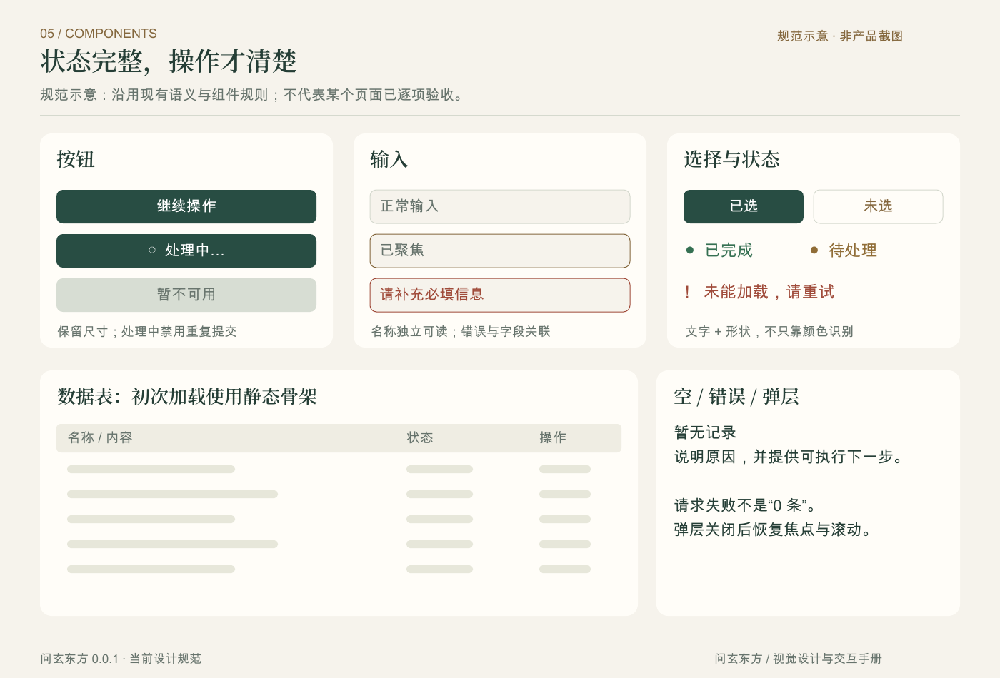

图 4：组件状态规范示意，不是真实业务页面截图。示意中历史用语不覆盖本册当前成长值与钱包定义。

## 9. 交互规范：东方珠作创作

编辑器以手串为主体，顶部保留名称 / 颗数、手围、内围预估与松紧反馈；预览下方或旁边是材料库，底部是材料预估、保存设计和去定制。扩大预览是辅助，默认状态也应看清手串；工具不得遮挡有效抓取与落点。

当前工作台统一使用 3D，拖动空白处旋转，双指缩放，复位恢复观察角度；浅色 / 深色按钮只改台面。挂件按配置的安装点与重力方向自然悬挂，固定串接材料保留自己的连接方式；侧面、平看和倾斜观察不改真实珠序。当前没有独立“平铺 / 悬挂”模式切换按钮；H5 立体渲染失败时使用可继续编排的平面降级预览，明确提示并提供重新加载。

直接拖珠换位，拖出手串范围出现“松手删除、移回取消”，松手才提交数据；取消与未形成有效轮廓的手势不得误删。一次换位或删除对应一次撤销。旋转、缩放、换台面不应计作配方修改。桌面提供方向键选珠、Alt + 方向键换位和 Delete 删除；原生保留可访问的等价动作，不要求用户只能完成复杂手势。

材料库当前为左侧竖向分类栏、关键词搜索与五行下拉。八个筛选入口为正在使用、全部、主珠、隔珠、佛头、三通、动态挂件、绳线；前两项是汇总筛选，不是另外两种材料。搜索、分类、五行共同过滤。材料显示规格、单价、已用数量与可用状态，库存不足、下架和满 60 颗的原因应可读。六个等宽五行按钮和旧材料收起快捷条不再作为当前编辑器规范。分类与连接方式分开：材料归类不改变穿绳、挂件连接或刚性 / 柔性运动配置。

天然材质的显示用于搭配预览。内围估算、屏幕纹理和颜色都需结合真实制作确认，不能以渲染精度承诺实物完全一致。

## 10. 交互规范：草稿、定稿与订单

“保存设计”保存个人可编辑草稿；“去定制”进入收货地址、用料和费用确认。保存成功必须以接口结果确认，失败保留草稿与输入并可重试，不先显示已保存。离开有修改的设计时应保留恢复与确认机制，不能因登录、返回或键盘弹出丢失作品。

广场展示不可变定稿，公开详情对本人也只读；编辑和发布统一在“我的设计”。复制 / 按此款创作产生自己的可编辑版本，不覆盖源作者作品。保存修改不下架已有定稿，状态显示“已发布 · 草稿已修改”；符合当前资格后再“发布新定稿”。下架保留已有副本与订单。

发布资格由服务端返回：订单须付款成功，且款式、用料、价格经审核确认；配方需与待发布草稿一致，取消、退款和售后限制遵守服务端校验。当前演示规则允许已成功模拟付款并经审核确认的订单形成展示定稿，但演示来源不计真实成交、创作现金奖励或正式成长收益。不得用“广场可见”证明真实付款，也不能沿用旧方案的“所有模拟订单一律不能发布”。

订单界面分别显示订单、支付、制作 / 服务、物流状态。材料成交价取订单快照，编辑器预估不冒充实付；含配件和绳线写“件材料”。模拟渠道在按钮与结果明确标注，状态未知先查单。没有真实物流单号、执行记录或回执时不造占位事实。

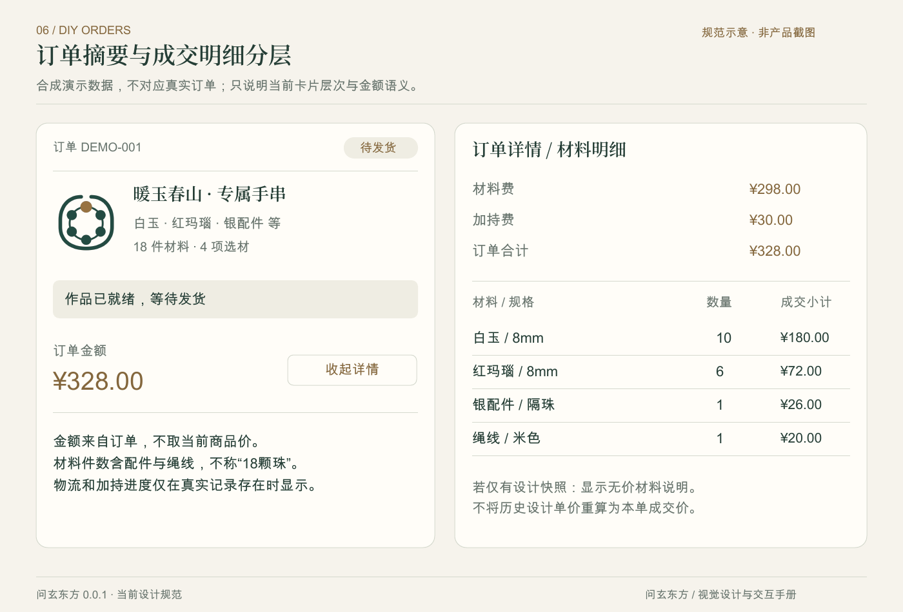

图 5：合成演示数据的订单示意，展示摘要与成交明细的分工，不证明真实扣款、制作、加持、发货或签收。

## 11. 交互规范：AI、成长与资产

AI 问事用“探索、问 AI、我的报告”组织入口，专题覆盖十二类。资料输入、补问、生成中、摘要就绪、未解锁、已解锁、失败与免费重试分别展示；资料和计算来源与解读文字分层。公开报告示例明确是合成资料与版式示例，不能让用户误认自己的结果。

生成摘要不扣款，完整报告按当前报价使用钱包余额解锁；价格从专题 / 报告与结算报价读取，不把某次观察的金额永久写死。不得恢复“积分解锁”。显示生成中不等于已付款，生成完成也不等于内容质量已通过。完整报告可回读、按章导航、放大字号，并携带已确认资料继续追问；AI 执行说明来自实际步骤，不用循环动画假装检索或计算。

钱包用人民币表示，积分用于兑换与活动，成长值只累计等级，创作收益另列账本；不以同色同图标合并余额，不恢复“功德值”作为个人成长名称。成长中心分档案、任务、明细、等级权益，规则版本并入权益说明。五级门槛为 0 / 200 / 1000 / 3000 / 8000；是否能享折扣取项目参与、预算、开关与实际报价，不据等级表宣传全站折扣。

## 12. 交互规范：合作与运营作业

法师工作台突出待办、预约、排班、执行与回执；寺院管理员统一管理本寺资料、师傅、服务、履约和结算。寺院不再设接待、运营、财务岗位入口；平台自定义岗位与寺院单管理员不是同一套规则。

统一运营管理台按十个工作区组织：工作台、机构与人员、服务与履约、商城与 DIY、审核与治理、财务中心、运营中心、AI 中心、基础标准、系统与权限。成长 / 积分 / 首页活动归运营，结算 / 提现 / 创作奖励归财务，模型 / 知识 / 评测 / 发布归 AI；商城业务在统一后台内，旧商城入口迁移到对应业务。

列表查询、详情读取与编辑操作区分权限；平台预约和咨询聚合为只读监管，不自动提供统一完成、退款或代履约。表格变更筛选回第一页，保留独立加载与失败。跨段保存按真实接口分别反馈，部分失败只重试失败段，不将多个写接口包装成不存在的原子保存。

银行打款与快递渠道未接入时按钮说明状态不变；人工凭证与模拟打款测试须明确自己的性质。模拟测试的虚拟对象、金额、结果不混进正式提现和结算。审核记录、业务日志与操作审计分别解释，不把某一个页面当成所有审计都完整的证明。

## 13. 动效与可访问性

Web 局部反馈沿用 120ms 快速、200ms 常规、280ms 入场、160ms 退出；主曲线为 `cubic-bezier(.2,.7,.2,1)`，落稳曲线为 `cubic-bezier(.22,1,.36,1)`。只在能解释状态、层次或真实等待时运动，不反复给列表入场、装饰或所有属性加过渡。

iOS 常用 120 / 200 / 280ms 局部反馈，系统导航、sheet 与返回手势交给原生。Web 遵守 prefers-reduced-motion，iOS 遵守减少动态效果；停用位移 / 旋转后仍保留选中、加载、错误和操作结果，不能让任务因此无法完成。

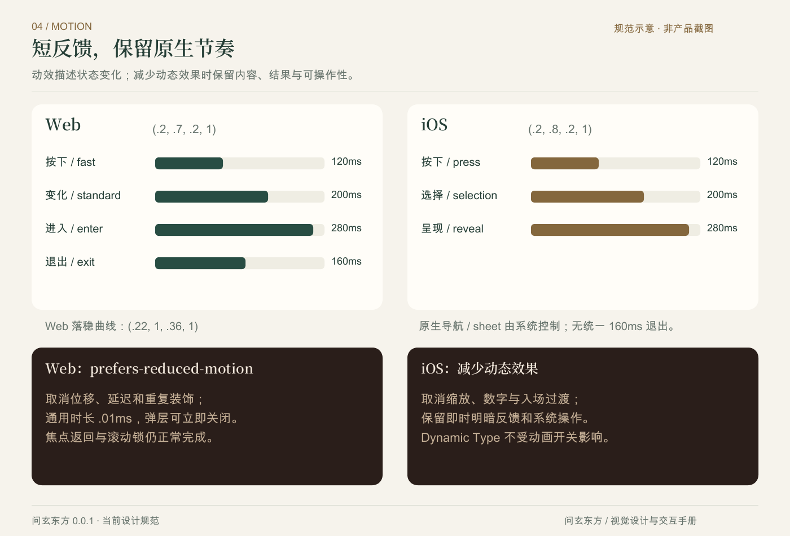

图 6：既有动效时间轴规范示意。Web 局部退出时长不能直接套用于原生系统导航。

所有关键状态均有文字，图标有可读名称，焦点清楚，金额带单位；键盘、触控与辅助技术有完成核心任务的路径。检查弹层焦点不跑到底层、关闭后正确恢复、键盘不挡提交、动态字号不截断、拖拽可撤销；不能以浅深主题截图代替这些交互检查。

## 14. 设计合作交付与验收

每组交付包含使用身份与任务、当前概念、页面结构、浅深主题、简繁文案、真实状态、响应式与关键操作说明；先核对当前总纲再复用历史原型。页内文案写用户实际能做的事；一个页面保留一个主标题，不默认叠加眉题、口号或同义副说明。费用、权限、审核、错误、演示与正式模式等会影响决定的信息保留在对应操作处。开发路径和测试步骤放交付附录。本轮仅同步 Web 实现，原生 iOS 另行验收。

| 交付对象 | 必备内容 | 检查方式 |
| --- | --- | --- |
| 产品发布与介绍 | 当前价值、角色、主要入口、演示标识与能力边界 | 与总纲、使用和合作手册一致 |
| 视觉设计 | 正式标识、语义色、字号、间距、图片比例及浅深主题 | 复用母版和令牌，不从旧截图吸色 |
| 交互设计 | 前置条件、成功 / 失败 / 等待 / 空态、返回、权限、金额来源 | 按任务实际操作，异常可恢复 |
| Web 适配 | 320 / 390 / 768px 与桌面代表宽度、短屏、键盘 | 无页面横溢、遮挡与无法操作位置 |
| 原生适配 | 安全区、动态字号、系统 sheet、侧滑、VoiceOver | 在对应设备单独记录结果 |
| 验收记录 | 源码、构建、夹具、浏览器、实机、部署分别列明 | 已观察与未执行分开，不扩展历史通过结论 |

本次为文档重梳与源码核对，不新增线上业务验收或设备通过结论。真实支付、渠道结算、完整原生与 WebView / PWA 安装态仍以独立验收为准，不能据本册发布而认定全部可用。

## 附录 A. 源码与证据索引

2026-10-29 核对本地已检出 frontend `33db6a03961f`、H5 `bfb6d36598b3`。这是文档依据，不是当前生产版本声明；其他仓库精确版本与能力边界以[代码核对索引](manual/代码核对索引.md)、[当前能力](../product/产品现状与能力边界.md)及本次同步报告为准。

| 内容 | 源码位置（相对前端仓库，H5 是独立仓库） |
| --- | --- |
| 颜色、字体、动效与品牌 | packages/design-tokens/tokens.json、typography.css、motion.css；packages/brand/assets |
| 首页与根导航 | apps/web-h5/src/routes/customer/Home.tsx、home.css；components/home/；components/Shell.tsx |
| DIY 工作区与降级 | apps/web-h5/src/routes/customer/DiyEditor.tsx；features/diy/Diy3DPreview.tsx、editor.css、spatialInteraction.ts、presentation.ts |
| DIY 定稿与报告 | apps/web-h5/src/routes/customer/Diy.tsx、DiyDetail.tsx、AiReports.tsx |
| 原生首页与创作 | apps/ios-customer/DongFangApp/Features/Home/HomeView.swift；Features/Diy/DiyDesignView.swift、DiyMyDesignsView.swift |
| 运营组件与导航 | packages/admin-ui；apps/web-platform-admin、apps/web-temple-admin |

目录筛选、定稿发布、后台与寺院角色的固定历史证据分别见[服务筛选更正](../reports/2026-10-21-找师傅服务筛选更正.md)、[v4 发布验收](../reports/2026-10-20-DIY定稿发布与首页统一.md)、[十工作区能力补齐](../reports/2026-10-22-管理能力补齐与模拟打款验收.md)、[寺院管理员简化](../reports/2026-10-23-寺院管理员简化验收.md)。报告只证明其注明的日期、版本与范围；旧版真实付款限制的后续变化以本册第 10 节及当前总纲为准。

## 附录 B. 历史图版的使用范围

本册语义色、品牌、字体、动效与订单图版是规范 / 合成示意，需随源令牌重新生成核对。下列页面图仅保留设计演进背景，不作为当前页面、功能入口或原生发布证明。

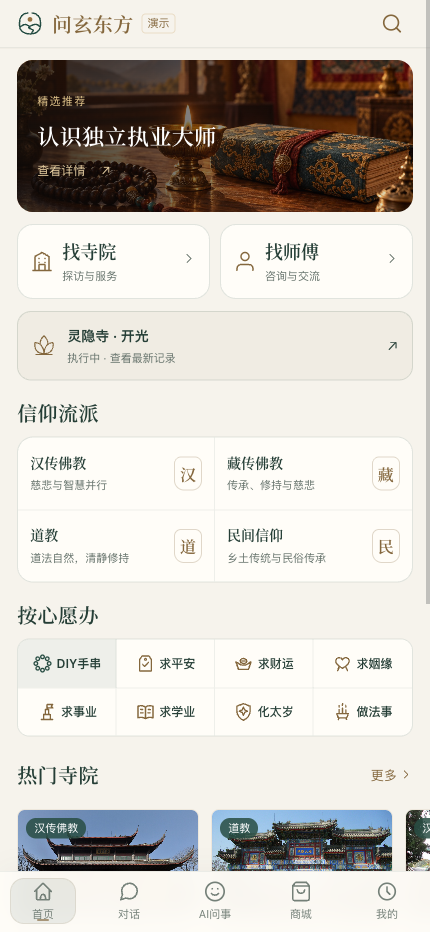
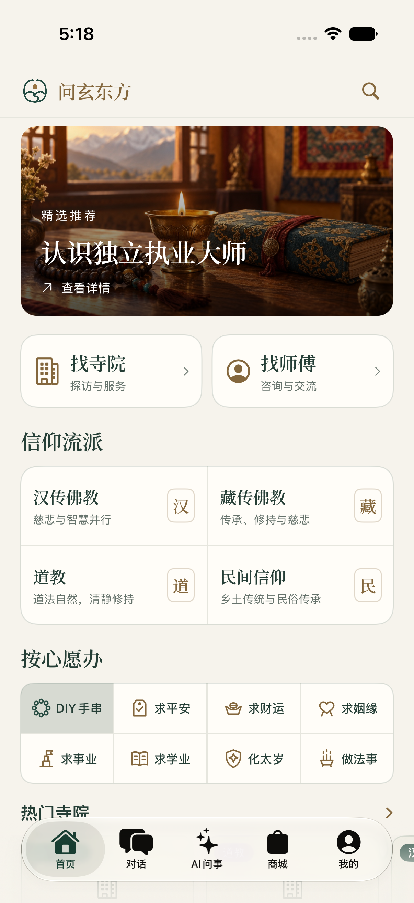

图 B1：2026-09-16 的 H5 线上与 iOS 模拟器截图；现行首页结构以第 6 节为准，两端来源不同。

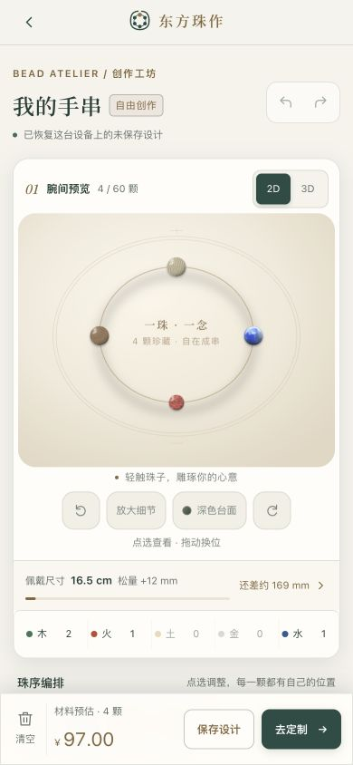
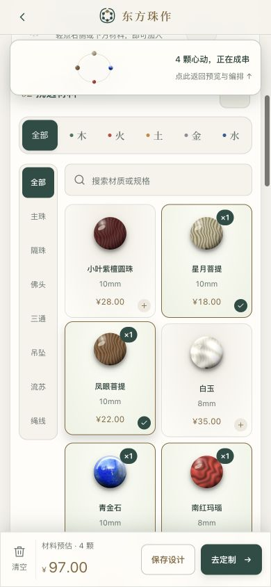

图 B2：2026-09-13 旧 DIY 工作台与材料布局。现行统一 3D、左侧竖向分类和五行下拉见第 9 节；旧图的固定比例画布与五行按钮排列不作为当前规范。

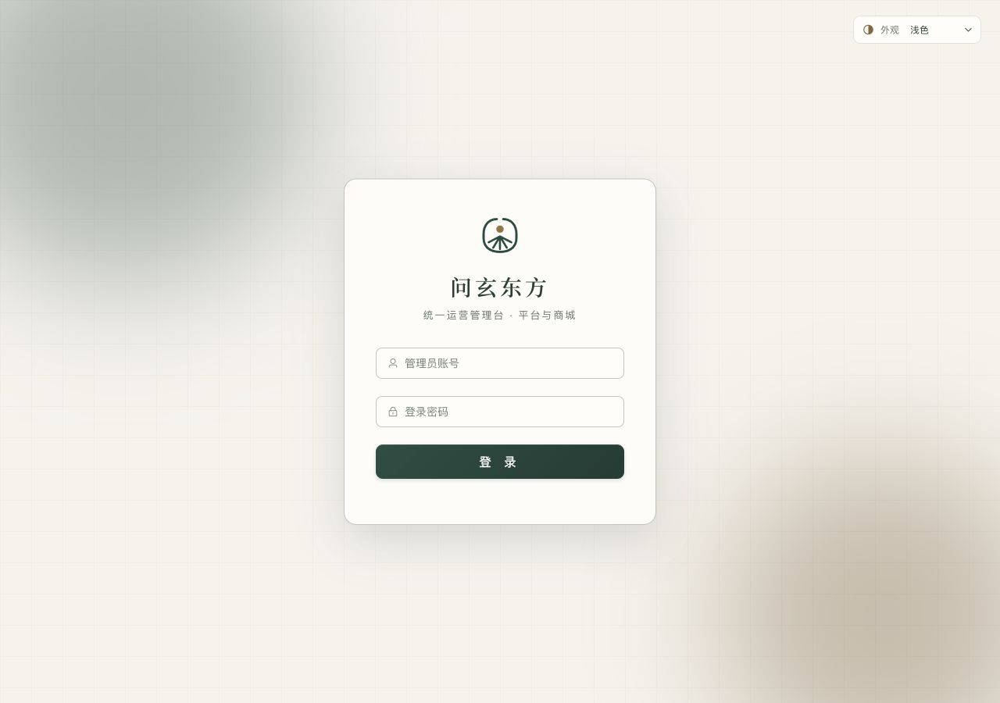
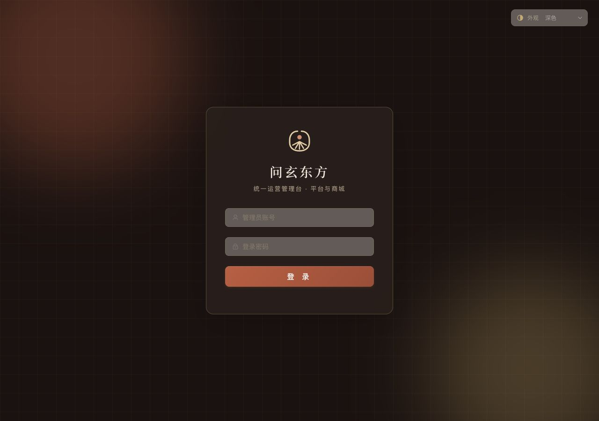

图 B3：2026-09-13 统一后台登录页实访，1280×900，只用于品牌演进参考；现行登录表单以账号、密码与图片验证码为准。
