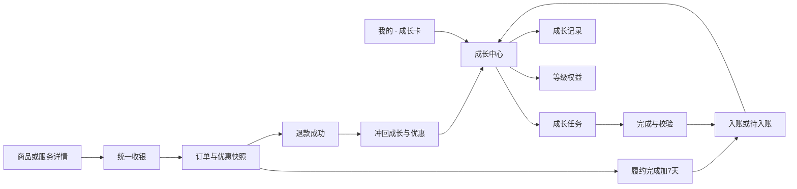

# 成长体系产品原型方案

| 项目 | 内容 |
| --- | --- |
| 产品 / 版本 | 问玄东方 · growth-v1 |
| 需求确认 | 2026-10-19；五级规则已确认，继续全端开发、测试、Git同步与ECS部署 |
| 当前阶段 | growth-v1 首期已合并，后端/H5/运营与寺院Web已部署ECS并完成下述验收；原生交付和未开放范围分别见第9—10节 |
| 适用形态 | 信众/法师 H5、PWA、双 iOS、内嵌 H5、寺院/统一运营 Web、Mac门户 |
| 可交互原型 | [打开标准页面原型](prototypes/growth-v1/index.html)；使用本地浏览器打开，所有数据均为示例 |
| 业务规则基线 | [五级成长体系完整规则](五级成长体系方案.md) |

## 1. 产品目标与边界

让用户看懂“如何成长、多久升级、当前能享什么、这一单省了多少”，让提供者看懂“是否参加、谁承担优惠、本人应得多少”，让运营能管理规则与预算并对账。

成长值仅累计等级，不支付、不兑换、不衡量宗教修为；人民币、积分、创作收益独立。现有五档门槛 0/200/1000/3000/8000、商品9.8/9.7/9.5/9.2折、服务最高9.5折按已确认规则执行。没有充值升等级、随喜升等级、等级提高中奖概率或所有交易统一打折。

## 2. 使用者与核心任务

| 使用者 | 核心任务 | 成功标准 |
| --- | --- | --- |
| 游客 | 了解成长规则 | 能看规则，个人数据明确需登录，无假0或L1 |
| 客户 | 完成任务、查成长、享优惠 | 同账号跨端一致，能追溯入账与退款，付款前确认实际优惠 |
| 法师/寺院 | 决定服务参与、查补贴及收入 | 只操作本人的项目，优惠不暗减合同应得 |
| 商城运营 | 配置参与商品、核对成本 | 项目级准入，毛利及预算不足不能违规发优惠 |
| 平台运营 | 配置规则、任务、预算、异常处理 | 有版本、权限、审核、幂等和审计，可核对每笔变化 |

## 3. 信息架构与流程

成长、支付、履约和退款是四条可关联的记录，不合并成一个“成功”状态。支付后仍需确认收货/回执/咨询结束/报告解锁条件；接单不等于服务完成。

## 4. 页面规格

| 编号 / 页面 | 布局及内容 | 主操作与跳转 | 权限 / 状态 |
| --- | --- | --- | --- |
| P01 成长统计入口 | 2026-10-20 调整为账户统计第一列，与积分、优惠券同高等宽，显示实际成长值；取消独立成长卡。等级、距下级差额及待入账在 P02 展示 | 点击进入 P02；游客登录返回本页，未登录不显示虚假余额；完整布局见[无框 DIY 与轻量导航 v2](无框DIY与轻量导航产品原型方案.md) | 客户本人；游客、加载、正常、错误 |
| P02 成长中心 | 等级卡、分段进度、任务/权益/记录入口；前台自动同步当前等级 | 去任务 P03、查权益 P05、记录 P04 | L5显示已达最高等级，不出现负差额 |
| P03 成长任务 | 任务列表：数量、剩余次数、资格、到账时间；学习/记录/官方活动/评价 | 学习内容、保存私密记录、报名、回原订单评价 | 已完成、额度已满、审核中、不可用；不发空任务 |
| P04 成长记录 | 总值/待入账；来源、增减、时间、状态、原因，按页加载 | 核对原单编号；在订单中心查询对应订单 | 入账、冲回、待观察、售后暂停；错误非0 |
| P05 等级权益 | 五档对照、当前档、适用范围、封顶、升级券及有效期 | 查折扣范围与升级券；收银台自动核对项目；月回顾/纪念卡 | 徽章可隐藏；券未用/已用/到期/撤回分开 |
| P06 统一收银 | 原价、优惠候选、选择方案、各费用项、实付、预计成长、到账规则 | 明确确认支付；切换方案重新报价 | 无优惠原因、封顶、报价过期、额度争抢、金额变化须重确认 |
| P07 订单/退款详情 | 原等级、原报价、行级实付及平台补贴；成长待入账/扣回在成长明细关联 | 查看履约、申请现有售后、回成长记录 | 按原单快照；退款不按现等级重定价 |
| P08 提供者参与 | 本人/本寺服务、参与状态、平台承担说明、原合同金额、用户实付与平台补贴账单 | 申请参与/退出；查看本人订单 | 未配置、待审、已参与、已停用；旧单继续履行 |
| P09 运营成长管理 | 规则版本、任务/内容、参与清单、预算、券、客户审计、对账 | 草稿预览、审批、启停、查询和补偿 | 按职责分权；金额/补账双人复核；不直接改余额 |
| P10 订单中心 | 服务、商城、手串共用导航、筛选、卡片、状态和金额层级 | 切换分类、进入详情、加载更多 | 首屏/追加加载分开；失败保留列表并可重试；末页显示全部加载 |
| P11 收货地址 | 从个人页进入独立管理页；地址卡片与默认标记 | 新增、编辑、设为默认、删除确认、返回个人页 | 登录后管理；表单校验、提交忙态、空列表、失败保留草稿；不在个人页下拉展开 |

| P12 商品详情等级价 | 商品/材料SKU、数量、等级、等级价、可用更低券价及不可用原因 | 切规格/数量重新取价；游客登录回原页；查看规则 | 报价有效30秒；失败/过期不保留可用价格；体验商品排除 |
| P13 规则与历史版本 | 当前及已生效历史版本、北京时间、五档/任务/封顶/说明 | 分页、展开详情；游客可只读 | 未来/取消版本只对运营可见；不读取游客个人账本 |
| P14 定时规则发布 | 基于当前版本的草稿、门槛/倍率/任务/券/上限、五档算例 | 预览→提交→另一管理员复核→到点生效；取消须再复核 | 草稿变更须重新预览；复核距生效须≥1分钟；每次最多一个未来版本 |

## 5. 关键交互细则

- **成长进度**：分段进度=(当前值−本级门槛)/(下级门槛−本级门槛)。示例L3/1250为12.5%，距L4还差1750；旁边分别展示待入账，不能提前填满进度。
- **任务完成**：提交忙态防重；网络不确定保留请求编号，先查状态再重试。学习必须达到有效阅读/播放条件；记录默认私密，删除正文不抹掉已经记账的必要凭据。
- **自动同步**：前台在线每15秒刷新，回到前台/恢复网络立即刷新；任务、支付确认成功后主动更新。正常服务下30秒内一致，离线/后台暂停；慢请求不重叠。刷新只合并服务器数据，保留笔记、规则、客服回复等草稿；切换账号立即清理个人数据，旧请求不得回写。
- **升级**：允许跨级，只展示最终等级和新增权益。服务端原子领取提示，同次变化多设备最多显示一次；非阻断提示可关闭，关闭不影响领券。退款降级不显示升级庆祝；原单不追补优惠，再次升回同级不重发礼券。
- **详情价格**：只提交目录ID、SKU/规格和数量；价格、参与方、等级、预算均由服务端核验。商城/DIY材料、寺院/师傅固定服务、咨询及人民币AI报告复用收银核算；既有报告按本人原报告价格预览。预览不建订单、不冻结优惠，最终收银仍须确认。
- **收银方案**：正常价、活动价、等级价、单张可用券价互斥比较；默认最优惠，同价优先不耗券。券/预算/当月额度并发占用时返回重新确认，不默默多扣款。
- **退款**：显示退款业务进度与成长冲回进度。成功后按净实付重算；观察期内取消待入账，已入账后才扣回总值；“退款处理中”不显示到账。余额订单当前只支持整单退款，不通过原型宣称已实现部分退款入口。
- **提供者参与**：管理端明确本次配置覆盖哪些具体SKU/服务，展示平台承担方式；退出仅影响新报价，不取消已冻结订单优惠。
- **列表与文案**：DIY订单仅保留“心意成串，静候相逢”；去掉英文、小字说明。私聊口号和会话总数置于列表及分页之后；去掉收藏重复标题和广场冗余提示。预约“加载更多”距离末张卡片24px，触控高度48px，重复响应不追加假数据。
- **收货地址**：个人页入口跳转`/c/addresses`，新增/编辑在该页完成；离开/切换账号清除上一账号地址和草稿。原生端保持原生独立导航。
- **运营发布**：完整不可变规则保存五档、五类任务及周期额度、折扣封顶、券、固定七天观察期/三十天券期。开关、预算和参与清单独立双人复核，不能由规则发布自动开启。规则从服务端时间生效，不依赖用户访问或后台任务触发；后台逐批协调等级券。旧预报价失效需重取，已支付订单及已发券原值不变。复核过期的草稿须重新申请，不追溯生效。

## 6. 状态与文案

| 状态 | 文案与行为 |
| --- | --- |
| 游客 | 登录查看成长等级；可读五级规则，不请求个人账本 |
| 加载 | 骨架或“正在读取成长记录”；不显示0冒充成功 |
| 正常无记录 | 成长从今天开始；显示可做任务 |
| 读取失败 | 暂时无法读取，重试；保留当前页面和草稿 |
| 任务达限 | 本月任务成长值已达上限；仍可正常阅读与记录 |
| 待入账 | 完成观察期后入账，并标预计日期 |
| 售后暂停 | 该订单售后处理中，成长值暂缓入账 |
| 退款降级 | 展示对应订单、扣回数量及新等级；已支付订单不补差价 |
| 项目不参与 | 本项目暂不参与等级优惠；有合格消费时仍可积累成长 |
| 封顶 | 本单等级优惠已达上限，明确实际减免 |
| 最高级 | 已达最高等级，继续记录成长 |
| 登录失效/换账号 | 清理账号缓存和报价；登录返回原入口，重新取本人数据 |

简繁使用共享文案；“成长值/成長值”“等级权益/等級權益”“待入账/待入帳”“退款扣回”口径一致。主题跟随用户设置，业务日期按上海时区、币种人民币，不随语言改变。

## 7. 各端适配与无障碍

H5/PWA 使用响应式卡片与列表，iOS使用原生导航、系统手势与动态字号；同一页面的业务字段和金额一致。Web/Mac管理端用可筛选表格及详情面板；小屏折叠为卡片，不隐藏关键金额。客户等级不等于法师执业评分。

正文与金额保证对比度；状态包含文字，键盘可操作；读屏能读等级、实际进度和价格组成。触控目标至少44px，320px无整页横向溢出；升级动效遵循减少动态效果，不反复播放。

## 8. 原型使用与验收

可交互原型支持页面导航、五档切换、游客/加载/错误/退款状态、跟随系统/简体/繁体语言、浅深主题和权益/收银方案预览，以及独立地址管理、订单分类与追加加载、SKU/数量报价、过期/优惠关闭状态、规则历史、双人复核和模拟到点生效。原型操作仅修改内存中的示例状态，不创建真实订单，不写用户数据。实际实现必须以服务端合同、预算和账本为准。

设计验收：页面P01—P14均有主路径与异常态；用户能解释成长与积分区别、知道本单为何打折或不打折、知道退款如何影响等级。功能验收及发布记录另按真实测试和版本填写，不能用可点击原型代替。

## 9. 实现与发布记录

详情等级价、自动同步、升级提示、规则版本的补齐批次见[2026-10-19 补齐验收记录](../reports/成长体系补齐验收-20261019.md)。以下保留首期发布事实，不用后续结果覆盖历史。

| 阶段 | 状态 / 证据 |
| --- | --- |
| 规则确认 | 已确认，见完整规则与五级表 |
| 产品原型 | P01—P11已完成；Ego Lite已观察地址新增/默认、五级礼券、繁体深色、提供者/运营/订单页面；学习示例重复点击只记一次；退款分别验证待入账取消总值不变和已入账290扣回后1250→960 |
| 后端实现 | [PR #5](https://github.com/askxuan-dongfang/askxuan-backend/pull/5) 合并为 `9ed258622f3c`；相关Go包、vet、10组成长MySQL事务及创作者净材料收益/退款回归通过 |
| Web接入 | [前端PR #4](https://github.com/askxuan-dongfang/askxuan-frontend/pull/4) 合并为 `c467d386b63f`，CI39225710842构建及ECS部署成功。运营/寺院成长页完成隔离样例验收 |
| H5接入 | [PR #2](https://github.com/askxuan-dongfang/askxuan-h5/pull/2) 合并为 `26046e3043e3`；共享前端锁定 `26719a02854f`。完整PR CI通过；样例分页20→23/失败重试、地址完整管理、聊天精简、320px成长/繁体深色通过 |
| 后端ECS | 发布 `ci-backend-39223708081-1-9ed258622f3c`。自动上传缓慢后取消，使用同一CI原始产物经正式接收器发布；artifact ID12172229319，整体摘要及20个二进制摘要核验通过。5个变更服务健康 |
| H5 ECS | 主分支CI39226763478代码检查通过，artifact存储配额导致上传失败；正式恢复工作流[39228592980](https://github.com/askxuan-dongfang/askxuan-h5/actions/runs/39228592980)从同一runner构建、测试及部署成功，发布 `ci-h5-39228592980-1-26046e3043e3` |
| H5最终修复 | [PR #3](https://github.com/askxuan-dongfang/askxuan-h5/pull/3) 修复重复筛选清空列表及地址编辑产生重复返回历史，CI39232946549通过；合并 `9187afcecb46`。已知artifact配额故障下取消重复的主流程39233879759，改用正式恢复流程[39234069406](https://github.com/askxuan-dongfang/askxuan-h5/actions/runs/39234069406)，完整检查与部署成功。最终发布 `ci-h5-39234069406-1-9187afcecb46`，接收器事务complete |
| 线上接口 | 总览/记录/内容/活动业务码0；五级门槛正确、折扣关闭；客户访问运营和提供者接口均返回业务码40304（HTTP200）。未写入测试资金或用户成长数据 |
| 线上浏览器 | Ego Lite：个人页进入独立地址管理，可打开新增表单；成长档案、五级权益、任务及空明细正确；繁体深色320px无横向溢出并恢复原设置；预约9/9末页不再出现无效加载按钮，商城5条/手串10条共用订单导航；私聊口号及8个会话位于列表底部，收藏和广场冗余文案移除。实际多页追加及错误重试使用本地23条样例验证，未为此生成线上订单 |
| 最终版本复测 | 浏览器加载 `index-BTvJc0ku.js`。新增地址取消、现有地址关闭编辑后，从列表一次返回个人页；地址数量保持1且未保存/删除。预约重复点击“全部”保持9条，切换“待确认”并重复点击保持4条，再切回全部9条 |
| 原生交付 | 双iOS模拟器构建及Mac universal构建通过。信众档案/任务/权益、法师参与页使用本地样例完成原生UI观察；Mac运营门户读取线上成长配置成功。真实设备、商店分发、寺院Mac登录后业务及完整VoiceOver未验收 |

仓库更新核对：远端master于2026-10-19 09:37提交 `3ab3376`，此前10月16、17日也有更新；五级设计提交 `43e00d4` 当时仅在本地分支。本轮将原型及实现证据一起维护在本仓库，归档目录只保存固定版本证据。

## 10. 配置初始值与当前业务边界

成长记录开放后，所有参与项和等级折扣默认关闭，等级优惠/升级券预算为0。运营须配置真实参与项目、成本和补贴预算，并由另一名管理员批准；提供者服务还需本人同意。无预算时礼券显示待发放，不承诺已可消费。模拟环境展示成长和权益规则，模拟支付不计消费成长。

现有DIY订单无独立制作费字段，本期不把未分项金额猜作材料或制作费；未来新增该字段时再接入获取成长规则。活动价候选由已有业务价格事实提供，不能由客户端自由填写促销金额。当前退款入口为整单退款，不增加部分退款入口。

原型按钮只操作示例内存；真实实现、隔离数据回归、线上只读验收和原生分发分别留证。
